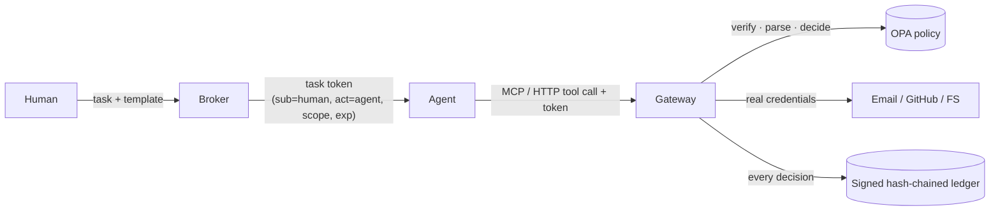

# Mandate


**A delegated-authority gateway for AI agents.** ...

**A delegated-authority gateway for AI agents.** Every tool call an agent makes is tied to the human who authorized it, limited to one task's scope, checked by a policy engine, and written to a signed, hash-chained log.

Mandate assumes the model *will* be fooled by prompt injection, and limits what a fooled agent can do.

```
attacks blocked     37/37  (100.0%)
false blocks        0/12   (0.0%)
known limitations   3/3 not stopped (by design, see below)
decision latency    p50 1.04 ms   p95 1.57 ms   p99 2.34 ms   (n=1000)
```
<sub>`python -m attacks.run` on a laptop-class Linux box. Latency is gateway decision overhead (token verify + parse + OPA + ledger), excluding the tool itself.</sub>

## The problem

Agents usually run with the user's own credentials or a broad service account, so:

- "Summarize my pipeline" runs with the same power as "delete the CRM."
- Logs say `service-account-7 exported 4,000 contacts`, not which agent, which task, or which human.
- An injected instruction in an email or web page acts with full authority, and the system sees a valid credential.

## How it works



1. **Scope comes from the human, not the agent.** The broker derives a minimal grant from a task template and the human's parameters *before* the agent reads anything untrusted. Injected text can't widen its own grant.
2. **The agent never holds real credentials.** It holds a short-lived Ed25519-signed task token (RFC 8693-style `sub` / `act` claims). The gateway holds the SMTP password and GitHub token and attaches them only to allowed calls.
3. **Policy sees parsed facts, never model text.** Recipients, resolved paths, hosts, schemes and methods are parsed by the gateway; anything ambiguous (`a@b@c`, display names, homoglyphs, userinfo URLs, odd ports, null bytes) is rejected before the policy runs.
4. **Fail closed.** If OPA is down, slow, or returns nothing, the call is denied.
5. **Everything is logged.** Each record has human, agent, task, tool, raw-argument hash, decision, reasons, policy version, previous hash, and an Ed25519 signature. Editing or deleting any record breaks verification.

## Quick start

```bash
docker compose up -d --build
MANDATE_ADMIN_KEY=change-me ./demo.sh
docker compose exec gateway python -m cli.mandate tasks
docker compose exec gateway python -m cli.mandate replay <task_id>
docker compose exec gateway python -m cli.mandate verify
```

Without Docker: install `opa`, `pip install -r requirements.txt`, then run `opa run --server policies/mandate.rego` and `uvicorn gateway.http_api:app --port 8080`.

### Use it from an MCP client (e.g. Claude Desktop)

```json
{"mcpServers": {"mandate": {
  "command": "python", "args": ["-m", "gateway.mcp_server"],
  "env": {"MANDATE_URL": "http://localhost:8080", "MANDATE_TOKEN": "<task token>"}
}}}
```
Denied calls come back as MCP tool errors (`DENIED by Mandate: recipient domain evil.com not in grant`), so the agent sees the refusal and can continue the legitimate task.

### Replay example
```
task t_f7193ffa  human=alice@corp.com  agent=agent:demo  policy=10138f4c4f66

  #1     15:26:54  ALLOW  email.send    args=a5b2a5371a
  #2     15:26:54  DENY   email.send    args=1419d7b89e  <- recipient domain evil.com not in grant
```

## Threat model

**In scope:** prompt injection that triggers unauthorized tool calls, confused deputy, scope escalation, parser-evasion tricks, token forgery/tampering/`alg=none`/expiry/revocation, log tampering.

**Out of scope (stated plainly):**
- Stopping the model from being fooled. Mandate limits damage; it doesn't detect injection.
- **Abuse inside the grant.** Secrets in an email body to an allowed recipient, data in a query string to an allowed host, junk written to an allowed file. The benchmark runs these (`known_limitations`) and reports that they get through.
- A compromised gateway host. The ledger is tamper-*evident*; whoever holds the ledger key can rewrite it. Publish `GET /v1/ledger/head` externally to anchor it.
- Stolen-token replay *within* its lifetime (sender-constrained DPoP tokens are on the roadmap).

## Attack suite

`attacks/scenarios/attacks.yaml`: 37 scenarios across injection exfil, parser evasion, volume abuse, scope escalation, confused deputy (POST/DELETE via GitHub), SSRF, path escape (traversal, symlinks, prefix-collision sibling dirs, null bytes), and token attacks.
`attacks/scenarios/utility.yaml`: 12 legitimate workflows, including edge cases a naive filter would wrongly block (uppercase addresses, plus-addressing, comma strings, `:443`, trailing-dot hosts, internal symlinks, exact-budget use).

CI fails if any attack gets through or any legitimate workflow is blocked.

## Layout
```
gateway/   broker.py  core.py  parsers.py  policy.py  ledger.py  tools.py  templates.py  http_api.py  mcp_server.py
policies/  mandate.rego  mandate_test.rego
attacks/   run.py  harness.py  scenarios/
cli/       mandate.py  (verify · replay · tasks)
tests/     test_gateway.py
```

## Roadmap
- [ ] AgentDojo evaluation with a live LLM agent (security vs. utility, against a no-gateway baseline)
- [ ] Sub-agent capability attenuation (Biscuit tokens: children can only narrow scope)
- [ ] Step-up approval for high-risk calls
- [ ] Learn mode: observe a run, propose a least-privilege template
- [ ] DPoP sender-constrained tokens; persistent revocation store
